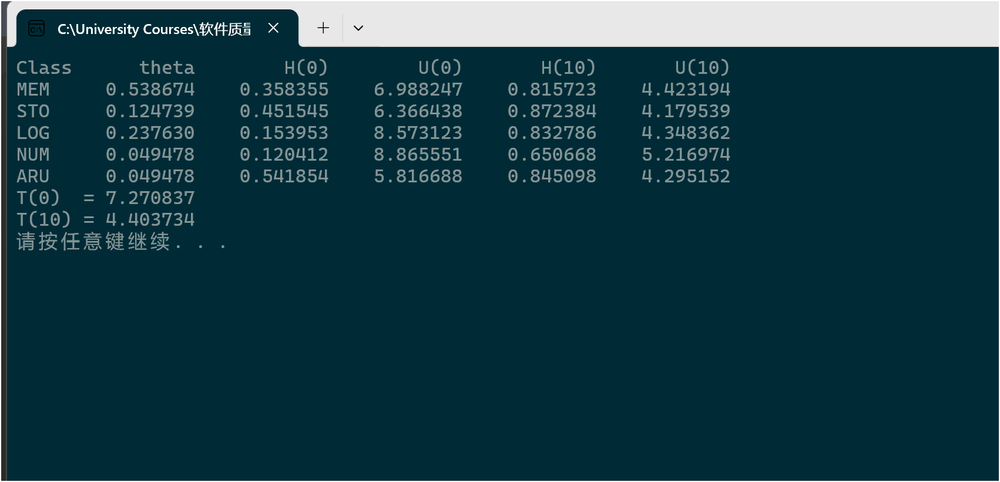

# 第9讲作业一和作业二

刘小凡　10244602411

## 作业一　软件老化的原因和影响

一台服务器刚启动时，读写文件、处理请求都能通过测试，连续运行几天以后，同样的操作却可能因空间不足而失败。两次运行用的是同一份代码，差别在于程序执行到这一步时，系统已经留下了多少未释放的资源，或者此前的运算已经积累了多大的误差。软件老化描述的正是这种现象。运行时间之所以重要，是因为一段有缺陷的操作有机会反复执行。对于同一缺陷，业务繁忙时一天内积累的问题，可能比空闲时一周积累的还多。

课件从成因上区分内存管理、存储空间、逻辑资源、误差累积和未知原因五类。前三类都涉及资源，但诊断时要分清究竟是什么先耗尽。对象使用完毕后仍被引用，会使后续请求可用的内存减少。磁盘上的数据已无业务用途，其占用的空间却可能一直得不到回收。套接字、索引节点等逻辑资源则有各自的数量上限，即使磁盘还有空余字节，索引节点耗尽也会使系统无法新建文件。数值误差走的是另一条路径，每次计算都能完成，结果却在反复更新中逐步偏离应有值。对于只能观察到故障随运行时间增加而更容易发生、尚未查明机制的情况，课件将其归入未知原因类。

Linux 的 ext3 日志文件系统曾出现过一种容易被短时测试漏掉的故障。按课件对 Bug3171 的记载，程序删除日志后，本应关闭相应的文件句柄，使占用的磁盘空间得以回收。一处代码嵌套错误使句柄没有关闭。此时查看目录，日志已经删除，单看删除操作的返回结果很难发现异常。随着日志不断产生和删除，未回收的空间逐渐挤占正常写入所需的容量。检验这个缺陷，可以在相近负载下连续执行多个日志轮转周期，分别记录每轮删除前后的可用空间。课件选择“预期之外的磁盘占用占总空间的比例”和“开始影响系统性能所需的时间”作为两项证据，恰好可以回答两个问题：损失了多少空间，以及业务还能正常运行多久。

温哥华证券交易所的股票指数则说明，软件一直在输出结果，也可能已经发生老化。按课件所述，该指数的初始值为 1000 点，每天约更新 2800 次。计算中对小数作截断处理，单次造成的偏差很小，但下一次更新又以上一次已经截断的结果为基础。由于误差反复朝同一方向累积，约一年后公布的指数已接近初值的一半。要发现这种问题，可以让同一串交易数据分别经过原算法和高精度算法，比较数千次更新后的两条指数序列。只核对第一笔交易，即使差值在允许范围内，也解释不了长期偏差。

两个案例的区别在于，前者最终影响的是系统能否继续提供服务，后者影响的是服务给出的结果是否值得相信。因此，评估软件老化既要观察故障发生的时刻，也要保存故障发生前的变化过程。将资源占用、结果偏差等证据与运行时间和操作次数对应起来，才能判断一次测试中看似微小的异常，是否正在演变为长期运行的风险。

## 作业二　软件老化可信度的计算

### 1. 输入数据

第 69 页题干写“四个类别”，第 70 页作业表和第 67 页示例均列出 MEM、STO、LOG、NUM、ARU 五类。下文按第 70 页的全部 30 个度量元计算软件可信度，并另列只取前四类时的结果。

下表各行均按第 70 页的度量元编号排列。每个时刻，同一度量元有多项证据时取其中最大的风险值。例如，存储空间度量元 S2 在 $t=10$ 的两项证据为 7 和 9，故取 9。

| 类别 | 各度量元的实例数 | $t=0$ 的最大风险值 | $t=10$ 的最大风险值 |
|---|---|---|---|
| MEM 内存管理 | 2 7 1 1 3 3 3 1 1 2 2 1 1 4 7 | 4 4 1 4 1 1 4 1 1 1 4 1 4 1 4 | 4 7 7 4 9 4 7 7 7 4 7 7 7 9 7 |
| STO 存储空间 | 1 1 1 1 | 4 1 4 4 | 7 9 7 7 |
| LOG 逻辑资源 | 2 1 1 2 1 1 1 | 1 1 4 1 1 1 7 | 7 10 7 4 7 10 9 |
| NUM 误差累积 | 1 2 | 4 1 | 7 4 |
| ARU 未知原因 | 1 3 | 1 4 | 7 7 |

LOG 的名称顺序在第 49 页和第 70 页之间有调整。本题将实例数、风险值按第 70 页的**列号和权重行**配对，其中 L1、L4 对应 0.2340，其余五列对应 0.1064。

### 2. 权重、类别熵与可信度

设同一类别中第 $j$ 个度量元包含 $c_j$ 个实例。按课件的 Brassard 优先顺序矩阵法，第 $j$ 行第 $k$ 列填写 $c_j/c_k$，对角线留空。先求行和，再除以全部行和之和，得到度量元权重。类别权重 $\theta_i$ 按同样的方法求取，此时比较的是各类别的度量元数，本题依次为 15、4、7、2、2。

$$
b_j=\sum_{k\ne j}\frac{c_j}{c_k},\qquad \beta_j=\frac{b_j}{\sum_k b_k}.
$$

在时刻 $t$，取度量元各项证据的最大风险值 $r_{ij}(t)$。按课件第 54、56、60、61、63 页，依次计算单项熵、类别熵、类别可信度及软件可信度。类别熵使用常用对数，可信度的指数函数以 $e$ 为底。

$$
S_{ij}(t)=\log_{10} r_{ij}(t),\qquad
H_i(t)=\sum_j\beta_{ij}S_{ij}(t).
$$

$$
K_i(t)=e^{-H_i(t)},\qquad
U_i(t)=\max\{1,10K_i(t)\},\qquad
T(t)=\prod_i U_i(t)^{\theta_i}.
$$

以 ARU 为例，两个度量元的实例数为 1 和 3。矩阵的两行之和分别为 $1/3$ 和 $3$，得到权重 $0.1$ 和 $0.9$。在 $t=0$ 时，A1 的风险值为 1，A2 的两项证据取最大值得 4。到 $t=10$ 时，两项度量元的风险值均为 7。

$$
\begin{aligned}
H_{\mathrm{ARU}}(0)&=0.1\log_{10}1+0.9\log_{10}4\approx0.541854, &
U_{\mathrm{ARU}}(0)&\approx5.816688,\\
H_{\mathrm{ARU}}(10)&=(0.1+0.9)\log_{10}7\approx0.845098, &
U_{\mathrm{ARU}}(10)&\approx4.295152.
\end{aligned}
$$

### 3. 计算结果

| 类别 | 类别权重 $\theta_i$ | $H_i(0)$ | $U_i(0)$（十分制） | $H_i(10)$ | $U_i(10)$（十分制） |
|---|---:|---:|---:|---:|---:|
| MEM | 0.538674 | 0.358355 | 6.988247 | 0.815723 | 4.423194 |
| STO | 0.124739 | 0.451545 | 6.366438 | 0.872384 | 4.179539 |
| LOG | 0.237630 | 0.153953 | 8.573123 | 0.832786 | 4.348362 |
| NUM | 0.049478 | 0.120412 | 8.865551 | 0.650668 | 5.216974 |
| ARU | 0.049478 | 0.541854 | 5.816688 | 0.845098 | 4.295152 |

**按表，软件可信度从 $T(0)=7.270837$ 降至 $T(10)=4.403734$。** 两次计算使用相同的实例数和类别权重。MEM 的权重超过一半，其可信度由 6.988247 降至 4.423194，对软件总分的下降影响最大。初始时刻已有多项风险值大于 1，因此初始可信度低于 10。

程序保留权重计算的中间精度。若直接使用第 70 页已舍入的度量元权重和第 59 页三位小数的类别权重，则 $T(0)=7.271014$、$T(10)=4.403326$。

若按题干只取表中前四类（MEM、STO、LOG、NUM），上述四行的类别熵和类别可信度仍适用。以 15、4、7、2 重新构造类别比较矩阵，四类权重依次为 0.585693、0.124115、0.250000、0.040192，此时 **$T(0)=7.339916$，$T(10)=4.402611$**。

### 4. 运行截图

### 附　C++ 源程序

~~~cpp
#include <algorithm>
#include <array>
#include <cmath>
#include <cstdlib>
#include <iomanip>
#include <iostream>
#include <numeric>
#include <set>
#include <stdexcept>
#include <string>
#include <vector>

using namespace std;

struct Category {
    string name;
    vector<int> counts;                   // 按作业表列序输入实例数
    vector<vector<int>> risk0, risk10;    // 每项保留全部证据
};

const vector<Category> homework = {
    {"MEM", {2,7,1,1,3,3,3,1,1,2,2,1,1,4,7},
     {{4},{4,1},{1},{1,4},{1},{1},{4},{1,1},{1},{1},{4,1},{1,1},{1,4},{1},{4}},
     {{4},{4,7},{7},{4,4},{9},{4},{7},{4,7},{7},{4},{7,7},{7,4},{7,4},{9},{7}}},
    {"STO", {1,1,1,1}, {{1,4},{1,1},{4},{4}}, {{4,7},{7,9},{7},{7}}},
    {"LOG", {2,1,1,2,1,1,1}, {{1},{1},{4},{1},{1},{1},{7}}, {{7},{10},{7},{4},{7},{10},{9}}},
    {"NUM", {1,2}, {{4},{1}}, {{7},{4}}},
    {"ARU", {1,3}, {{1},{1,4}}, {{7},{7,7}}}
};

// Brassard 优先顺序矩阵对角线留空，再将各行之和归一化。
vector<double> weights(const vector<int>& counts) {
    if (counts.size() == 1) return {1.0};
    vector<double> sums(counts.size(), 0.0);
    for (size_t i = 0; i < counts.size(); ++i)
        for (size_t j = 0; j < counts.size(); ++j)
            if (i != j) sums[i] += static_cast<double>(counts[i]) / counts[j];
    double total = accumulate(sums.begin(), sums.end(), 0.0);
    for (double& x : sums) x /= total;
    return sums;
}

double entropy(const vector<vector<int>>& evidence, const vector<double>& beta) {
    double h = 0;
    for (size_t j = 0; j < evidence.size(); ++j) {
        int risk = *max_element(evidence[j].begin(), evidence[j].end());
        h += beta[j] * log10(risk);
    }
    return h;
}

vector<Category> readInput() {
    cout << "Number of categories (1-5), then one ID and its counts per row:\n";
    int n;
    if (!(cin >> n) || n < 1 || n > 5) throw runtime_error("Invalid category count");
    vector<Category> result;
    set<string> seen;
    for (int i = 0; i < n; ++i) {
        string id;
        cin >> id;
        auto it = find_if(homework.begin(), homework.end(),
                          [&](const Category& c) { return c.name == id; });
        if (it == homework.end() || !seen.insert(id).second)
            throw runtime_error("Unknown or duplicate category: " + id);
        Category c = *it;
        for (int& count : c.counts)
            if (!(cin >> count) || count <= 0) throw runtime_error("Expected positive case count");
        result.push_back(c);
    }
    return result;
}

void calculate(const vector<Category>& categories) {
    vector<int> sizes;
    for (const auto& c : categories) sizes.push_back(static_cast<int>(c.counts.size()));
    auto theta = weights(sizes);
    array<double, 2> software = {1.0, 1.0};
    cout << fixed << setprecision(6);
    cout << "Class      theta        H(0)        U(0)       H(10)       U(10)\n";
    for (size_t i = 0; i < categories.size(); ++i) {
        const auto& c = categories[i];
        auto beta = weights(c.counts);
        cout << left << setw(5) << c.name << right << setw(11) << theta[i];
        for (int t = 0; t < 2; ++t) {
            double h = entropy(t == 0 ? c.risk0 : c.risk10, beta);
            double u = max(1.0, 10.0 * exp(-h));
            software[t] *= pow(u, theta[i]);
            cout << setw(12) << h << setw(12) << u;
        }
        cout << '\n';
    }
    cout << "T(0)  = " << software[0] << "\nT(10) = " << software[1] << '\n';
}

int main(int argc, char* argv[]) {
    int status = 0;
    try {
        if (argc == 1) calculate(homework);
        else if (argc == 2 && string(argv[1]) == "--input") calculate(readInput());
        else throw runtime_error("Usage: run without arguments or use --input");
    } catch (const exception& e) {
        cerr << e.what() << '\n';
        status = 1;
    }
    cout.flush();
    system("pause");
    return status;
}
~~~
